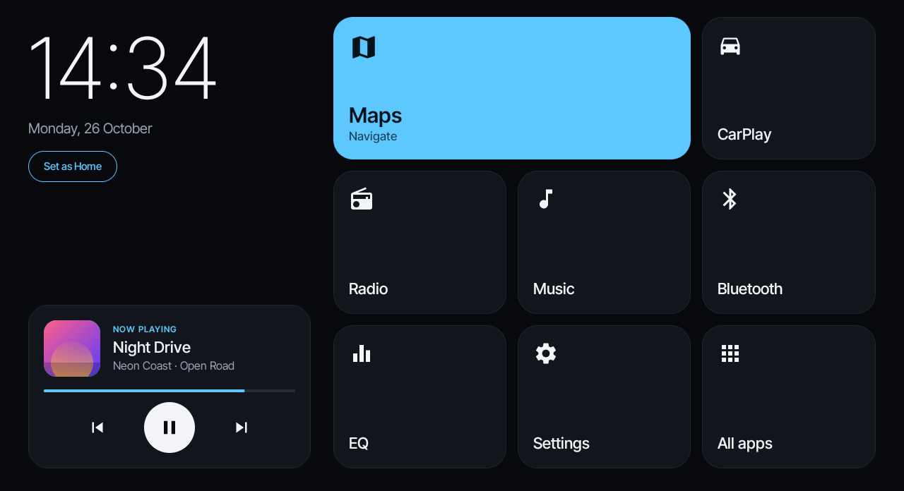
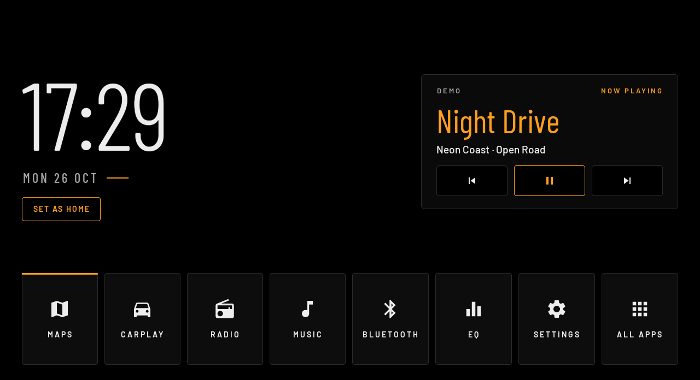
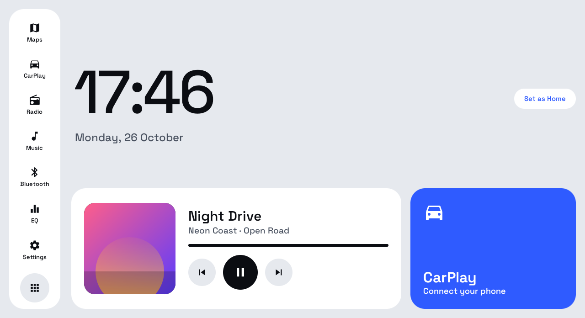
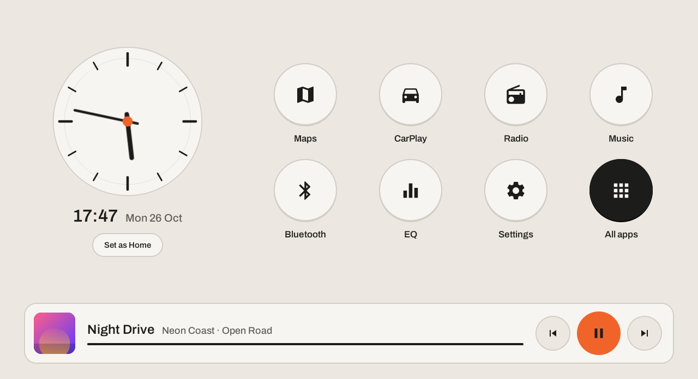
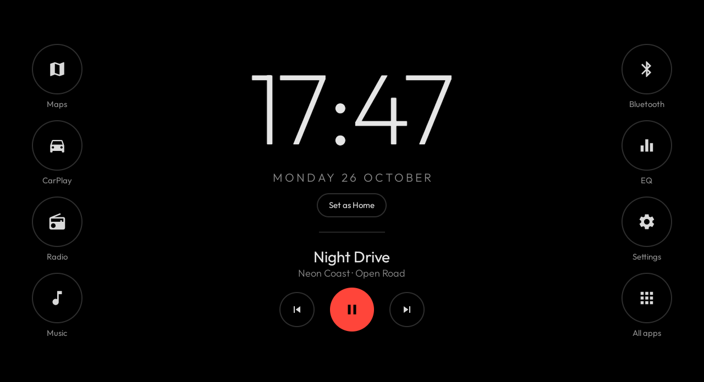
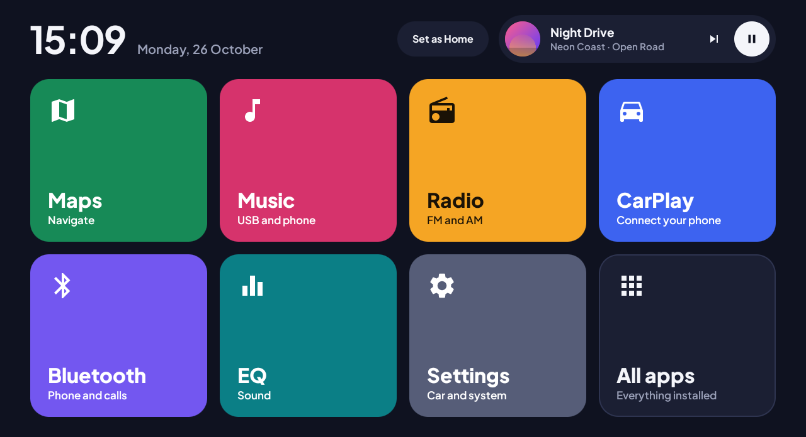
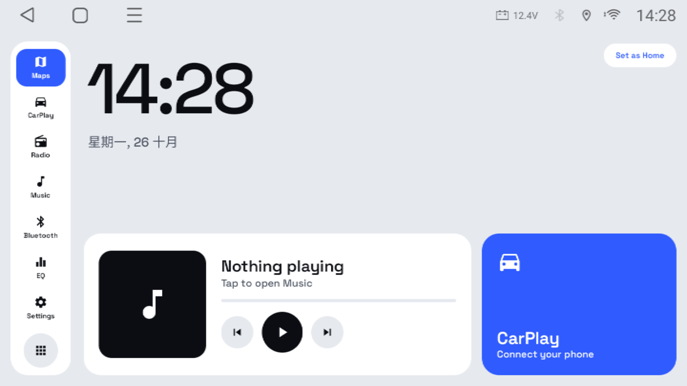

# CleanDash

[English](README.md) | 简体中文

一款简洁、无冗余的安卓车机桌面（启动器），适用于速卖通（AliExpress）上常见的后装车机：Topway TS10/TS18、FYT、Microntek 等。

灵感来自 [cleanyourtv](https://github.com/Gathin23/cleanyourtv)。

> 目前 CleanDash 的界面文字只有英文，下文中的按钮和菜单名称保留英文原文，括号内为中文说明。

## 截图

**Glass Cockpit（玻璃座舱）**

**Instrument（仪表）**

**Driver Rail (light)（驾驶侧栏，浅色）**

**Analog Studio (light)（模拟工作室，浅色）**

**Night Halo（夜光环）**

**Color Cards（彩色卡片）**

以上六张截自安卓模拟器，分辨率与 TS18 相同（1280×720），播放的是演示曲目，并装了占位应用，让每个图块都有可打开的应用。下面这张截自一台真实的 Topway TS18（Android 10），顶部是车机自带的状态栏，当时没有在播放：

## 功能

只有一个屏幕：大号时钟和日期、正在播放的内容，以及 **Radio（收音机）、Music（音乐）、Bluetooth（蓝牙）、Maps（地图）、CarPlay、Settings（设置）、EQ（均衡器）** 和 **All apps（全部应用）** 这几个大图块。图块打开的是车机上已有的应用，CleanDash 不会替换它们。

六种外观，长按时钟 → *Theme*（主题）切换：

- **Glass Cockpit：** 深色。左侧是时钟和正在播放，右侧是图块网格，地图图块加宽。
- **Instrument：** 黑底琥珀色。大号窄体时钟、仿液晶屏的媒体面板，底部一排八个按键。
- **Driver Rail (light)：** 白天用的浅色主题。左侧图标栏、大号时钟、正在播放和 CarPlay 卡片。
- **Analog Studio (light)：** 暖色调的白天主题。指针表盘、八个圆形按键和正在播放栏。
- **Night Halo：** 接近纯黑，适合夜间驾驶。左右两侧各四个圆形按键，拇指不用看也能摸到。
- **Color Cards：** 每个应用一种颜色，两排大卡片，顶部是时钟和迷你播放器。

每个主题都适配 1024×600 及以上的横屏：已在 1024×600、1280×720、1920×720 和 2000×1200 上检查过。暂不支持竖屏（"特斯拉式"）车机。

以下功能在每个主题里都一样：

- 每个图块会自动找到对应的应用。先找车机自带的界面（Topway `com.tw.*`、FYT `com.syu.*`、Microntek），再找名字相符的应用（"ZLink"、"CarPlay"、"FM Radio"……），最后用安卓的标准处理方式。
- **长按图块**可以改选别的应用。选 *Automatic*（自动）则恢复自动查找。
- 找不到应用的图块会变暗。点按或长按它即可选择一个应用。
- **正在播放**显示当前播放应用的曲名、歌手和封面，带播放/暂停、上一首和下一首按钮。点按卡片会打开那个播放应用。读取其他应用的播放信息需要"通知使用权"，这是安卓的要求：点按卡片后为 CleanDash 打开即可，或者运行
  `adb shell cmd notification allow_listener io.github.donnyyu.cleandash/io.github.donnyyu.cleandash.MediaListener`。
  CleanDash 不会读取通知内容本身。
- **长按时钟**可以切换主题、打开主屏幕设置，或把所有图块恢复为自动。
- **All apps** 列出所有已安装的应用。在其中长按某个应用可打开它的应用信息。
- 不申请联网权限，没有任何跟踪，不用 AndroidX，不用 Kotlin。纯 Java，只用系统自带的控件。

## 安装

1. 编译：`./gradlew assembleRelease`（需要 JDK 17 和 Android SDK platform 34）。APK 在
   `app/build/outputs/apk/release/app-release.apk`。
2. 把 APK 复制到 U 盘，用车机的文件管理器打开安装；或者开启调试后用 `adb install app-release.apk` 安装。
3. 先从应用列表打开 **CleanDash**，当作普通应用试用。
4. 满意之后，点 **Set as Home**（设为主屏幕），选择 CleanDash。

只有完成第 4 步，CleanDash 才会成为主屏幕：它的主屏幕入口默认是关闭的。

## 开发者选项和 USB 调试（Topway TS18）

TS18 的固件给这两项都加了密码：

- **开发者选项：** `7890` 加上车机时钟的当前小时（24 小时制）。10 点多是 `789010`，下午 3 点多是 `789015`。
- **USB 调试：** `john@tw-desktop`
- **工厂设置**（在车辆设置应用里）：`123456`

这类车机的 USB 口很多只能做主机（接 U 盘），用数据线连电脑往往连不上 ADB。可以改用 Wi-Fi 无线 ADB，直接在车机上开启：

1. 车辆设置 → 工厂设置（`123456`）→ 工程模式（Engineer Mode）→ Debug&Log → ADB shell。
2. 输入 `setprop service.adb.tcp.port 5555`，点 Start。
3. 在开发者选项里把 USB 调试关掉再打开，让 ADB 在 5555 端口重新启动。
4. 在同一 Wi-Fi 下的电脑上运行 `adb connect <车机 IP>:5555`，然后在车机屏幕上点允许。

重启后这个设置会失效。想让无线 ADB 重启后仍然保持开启，连上后运行一次
`adb shell setprop persist.adb.tcp.port 5555`；用 `adb shell setprop persist.adb.tcp.port ""` 可以撤销。
5555 端口没有加密，同一 Wi-Fi 下的任何设备都可以尝试连接。

工程模式也可以通过拨号 `*#*#83781#*#*` 打开。资料来源：[StarMusa88 的 Topway ADB 指南](https://github.com/StarMusa88/TopWay-Android-Headunit-ADB-Guide)和 [electronics101clt 的 UIS7862 笔记](https://github.com/electronics101clt/uis7862a-1h10-headunit)。

## 换回原来的桌面

安卓设置 → 应用 → 默认应用 → 主屏幕应用 → 选择原厂桌面。也可以长按 CleanDash 的时钟，选择 *Home screen settings*（主屏幕设置）。CleanDash 从不停用或卸载任何应用，原厂桌面一直都在。

## 状态

早期版本。已在 Topway TS18（紫光展锐 SC9863A，Android 10，1280×720）和安卓模拟器上运行。CleanDash 的界面目前只有英文。

## 参与开发

欢迎提交 pull request：问题修复、更多车机的适配和新主题。项目原则、编译测试方法和代码结构见 [CONTRIBUTING.zh-CN.md](CONTRIBUTING.zh-CN.md)。

## 许可证

[MIT](LICENSE)。第三方组件见 [NOTICE.md](NOTICE.md)。
